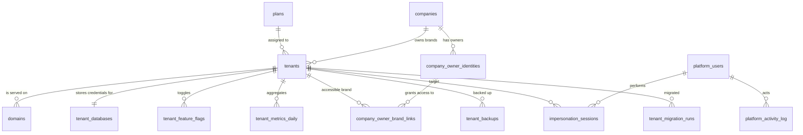
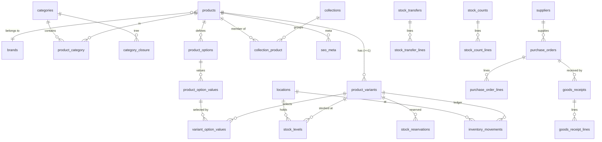
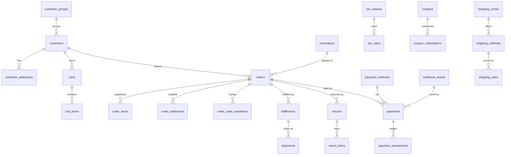

# Data Model — Landlord and Tenant ERDs

Scope: the **core** tables needed through Phase 3, plus every landlord table. Later modules
(Reviews, Wishlist, Content beyond pages, Reporting aggregates, Integrations) are listed in
§5 as planned shapes and will be detailed in their own phase plans.

## 0. Conventions that apply to every table (FINAL — spec §6.3)

| Rule | Detail |
|---|---|
| Engine | PostgreSQL 17+, UTF-8, single `public` schema per database. |
| Primary keys | `id BIGSERIAL` internal. **Never exposed.** |
| Public identifiers | `ulid CHAR(26) NOT NULL UNIQUE` on every entity reachable by API or URL. |
| Timestamps | `timestamptz`, stored UTC, rendered in the tenant timezone. |
| Money | `BIGINT` in minor units (paisa) plus a `char(3)` currency code. Never float, never decimal-in-PHP-float. Column pairs are named `<thing>_amount` / `<thing>_currency`. |
| Quantities | `INTEGER` for stock counts, `NUMERIC(12,3)` only where fractional units are genuinely needed (weight). |
| Foreign keys | On every relationship. `RESTRICT` on anything financial or historical; `CASCADE` only for true child rows (e.g. `order_items` of an order are never deleted — see invariants). |
| Checks | `CHECK` constraints for invariants: positive quantities, non-negative stock unless backorders allowed, valid enum values. |
| Uniqueness | Scoped unique constraints; **partial unique indexes** where uniqueness applies only to live rows, e.g. `CREATE UNIQUE INDEX ON products (slug) WHERE deleted_at IS NULL`. |
| Flexible data | `jsonb` (never `json`) for page-builder sections, settings, gateway payloads. GIN indexes where queried. Never for data needing relational integrity. |
| Soft deletes | `deleted_at` only where business-appropriate (products, customers, pages). **Never** on ledgers or financial records. |
| Append-only | `inventory_movements`, `payment_transactions`, `webhook_events`, `activity_log`, `login_audits` — enforced at DB level by revoking `UPDATE`/`DELETE` from the application role ([database-roles.md](database-roles.md)). |

---

## 1. Landlord database ERD

Holds platform data only. **No tenant customer, order, product or payment data ever.**

### 1.1 `companies` — the contracting/billing party

| Column | Type | Notes |
|---|---|---|
| `id` | bigserial PK | |
| `ulid` | char(26) unique | |
| `legal_name` | text | |
| `display_name` | text | |
| `slug` | text unique | |
| `contact_name`, `contact_email`, `contact_phone` | text | |
| `country_code` | char(2) | default `PK` |
| `contract_status` | text | `prospect` / `active` / `suspended` / `ended` (CHECK) |
| `billing_notes` | text null | |
| `created_at`, `updated_at` | timestamptz | |

Holds **no brand data** — it only groups brands for contracts, billing, reporting, support.

### 1.2 `tenants` — one row per brand (one website, one database)

| Column | Type | Notes |
|---|---|---|
| `id` | char(26) PK | the tenant id is a ULID; it appears in DB names, cache prefixes, storage paths, Typesense collections |
| `company_id` | bigint FK → companies | RESTRICT |
| `name` | text | brand name, e.g. `Velvina Home` |
| `slug` | text unique | e.g. `velvina-home` |
| `status` | text | `provisioning` / `active` / `suspended` / `archived` (CHECK) |
| `plan_id` | bigint FK → plans, null | |
| `topology` | text | `shared` / `dedicated` (CHECK) — spec §4.3 |
| `schema_version` | text null | last successfully applied migration batch marker |
| `default_currency` | char(3) | default `PKR` |
| `default_timezone` | text | default `Asia/Karachi` |
| `default_locale` | text | default `en` |
| `theme_id` | text | theme package key, e.g. `velvina-home` |
| `data` | jsonb | stancl/tenancy virtual-column overflow |
| `provisioning_state` | jsonb | completed provisioning steps, making `tenant:create` re-runnable |
| `health_status`, `health_checked_at` | text / timestamptz | populated by the health job |
| `last_backup_at` | timestamptz null | |
| `created_at`, `updated_at` | timestamptz | |

### 1.3 `domains`

| Column | Type | Notes |
|---|---|---|
| `id` | bigserial PK | |
| `tenant_id` | char(26) FK → tenants | CASCADE |
| `hostname` | text **unique across the whole table** | the resolution key; uniqueness here is what makes hostname resolution unambiguous |
| `kind` | text | `storefront` / `admin` / `api` (CHECK) |
| `is_primary` | boolean | one primary per (tenant, kind) — partial unique index |
| `created_at`, `updated_at` | timestamptz | |

Unknown hostname → 404, never a default tenant (spec §4.2).

### 1.4 `tenant_databases` — connection details, credentials encrypted

| Column | Type | Notes |
|---|---|---|
| `id` | bigserial PK | |
| `tenant_id` | char(26) FK → tenants unique | |
| `host`, `port`, `database` | text / int / text | |
| `app_username` | text | least-privilege DML role |
| `app_password` | text | **encrypted at rest** (Laravel encrypted cast) |
| `migration_username` | text | schema owner, used only during deploys |
| `migration_password` | text | **encrypted at rest** |
| `created_at`, `updated_at` | timestamptz | |

`.env.example` carries placeholders only; no real credential ever enters the repo (spec §8).

### 1.5 `plans` and `tenant_feature_flags`

`plans`: `id`, `key` unique, `name`, `default_features jsonb`, timestamps.

`tenant_feature_flags`: `id`, `tenant_id` FK, `key` (e.g. `wishlist`, `reviews`, `blog`,
`multi_location_inventory`), `enabled boolean`, `value jsonb null`, timestamps.
Unique on `(tenant_id, key)`. The effective flag set is the plan default overridden by the
tenant row.

### 1.6 Multi-brand owner access (spec §4.1a)

`company_owner_identities`: `id`, `ulid`, `company_id` FK, `email` unique, `password_hash`,
`name`, `two_factor_secret` (encrypted), `two_factor_confirmed_at`, `last_login_at`,
`status`, timestamps.

`company_owner_brand_links`: `id`, `company_owner_identity_id` FK, `tenant_id` FK,
`tenant_staff_user_ulid` (the ULID of the staff row **inside** that tenant's database),
`granted_by_platform_user_id` FK, `granted_at`, `revoked_at null`.
Unique on `(company_owner_identity_id, tenant_id)`.

The link stores only a ULID pointer. Permissions live entirely in the tenant database, so
no permission data and no brand data crosses into the landlord DB.

### 1.7 Platform team, audit, impersonation

`platform_users`: `id`, `ulid`, `name`, `email` unique, `password_hash`,
`two_factor_secret` (encrypted), `two_factor_confirmed_at`, `role`, `status`,
`last_login_at`, timestamps.

`platform_activity_log`: append-only. `id`, `platform_user_id` FK null, `event`,
`subject_type`, `subject_id`, `tenant_id` null, `properties jsonb`, `ip`, `user_agent`,
`created_at`.

`impersonation_sessions`: `id`, `ulid`, `platform_user_id` FK, `tenant_id` FK,
`target_staff_user_ulid`, `reason text NOT NULL`, `started_at`, `expires_at`, `ended_at`,
`ip`, `user_agent`. A reason is mandatory; the session is time-limited and mirrored into the
tenant's own activity log.

### 1.8 Operations metadata

`tenant_metrics_daily`: `id`, `tenant_id` FK, `date`, `orders_count`, `gross_sales_amount`,
`gross_sales_currency`, `sessions_count null`, `computed_at`. Unique on `(tenant_id, date)`.
**Non-sensitive aggregates only** (spec §4.9) — no customer or order-level rows.

`tenant_backups`: `id`, `tenant_id` FK, `kind` (`logical` / `pitr`), `location`,
`size_bytes`, `checksum`, `started_at`, `finished_at`, `status`, `error null`.

`tenant_migration_runs`: `id`, `tenant_id` FK, `release_version`, `batch`, `status`
(`pending`/`success`/`failed`), `error null`, `started_at`, `finished_at`. This is what makes
"a failed tenant migration blocks the release" reportable per tenant (spec §4.7).

`releases`: `id`, `version`, `git_sha`, `deployed_at`, `deployed_by`, `notes`.

---

## 2. Tenant database — identity, settings

Identical schema in every tenant database.

`users` (staff): `id`, `ulid`, `name`, `email` unique, `password_hash` (Argon2id),
`two_factor_secret` (encrypted), `two_factor_recovery_codes` (encrypted),
`two_factor_confirmed_at`, `status`, `last_login_at`, `landlord_owner_identity_ulid null`
(set when this staff row is the local account of a company owner), timestamps, `deleted_at`.

`login_audits` (append-only): `id`, `subject_type` (`staff`/`customer`), `email_attempted`,
`user_id null`, `successful boolean`, `failure_reason null`, `ip`, `user_agent`,
`created_at`. Indexed on `(email_attempted, created_at)` for throttling forensics.

spatie/laravel-permission tables (`roles`, `permissions`, `model_has_roles`,
`model_has_permissions`, `role_has_permissions`) live in the tenant DB. Seeded roles per
tenant: Owner, Manager, Order Handler, Inventory Staff, Content Editor, Accountant.

spatie/laravel-activitylog `activity_log` (append-only) and Sanctum
`personal_access_tokens` are tenant-local.

`settings`: `id`, `group`, `key`, `value jsonb`, `is_encrypted boolean`, timestamps.
Unique on `(group, key)`. Holds store info, currency, timezone, tax mode, mail branding,
robots settings.

---

## 3. Tenant database — Catalog, Inventory (Phase 2)

### 3.1 Catalog

`products`: `id`, `ulid`, `brand_id null` FK, `title`, `slug` (partial unique where not
deleted), `description`, `short_description`, `status` (`draft`/`active`/`archived` CHECK),
`type`, `tax_class_id null` FK, `published_at null`, `sort_order`, `attributes jsonb`,
timestamps, `deleted_at`.

`product_variants` — **every sellable item is a variant; a simple product has exactly one**
(FINAL): `id`, `ulid`, `product_id` FK CASCADE, `sku` (unique, partial where not deleted),
`barcode null`, `price_amount bigint`, `price_currency`, `compare_at_price_amount null`,
`cost_amount null` (weighted average, maintained by Inventory), `weight_grams null`,
`dimensions jsonb null`, `allow_backorder boolean default false`, `is_default boolean`,
`position`, `status`, timestamps, `deleted_at`.
SKU, price, weight, barcode and stock live **only** here (FINAL — spec §6.3).

`product_options` (`Color`, `Size`) / `product_option_values` / `variant_option_values`
model the variant matrix. Unique on the full option-value set per product to prevent
duplicate variants.

`categories`: `id`, `ulid`, `parent_id null` FK, `name`, `slug`, `description`,
`position`, `is_visible`, timestamps, `deleted_at`. Unlimited depth.
`category_closure`: `ancestor_id`, `descendant_id`, `depth` — PK `(ancestor_id,
descendant_id)`. Closure table chosen over `ltree`; see
[ADR-0006](../adr/0006-category-tree-closure-table.md).

`brands`, `collections` (`is_dynamic boolean`, `rules jsonb` for rule-based collections),
`collection_product`, `product_category`, `product_related`, `attributes`,
`attribute_values` follow the same conventions.

`media` (spatie/laravel-medialibrary): its own table, `model_type`/`model_id` polymorphic,
conversions generated by queued jobs, stored under the tenant's object-storage prefix, with
`alt_text` in `custom_properties`.

`seo_meta`: `id`, `model_type`, `model_id`, `title null`, `description null`,
`canonical_url null`, `robots null`, `og_image_media_id null`, timestamps. Unique on
`(model_type, model_id)`.

`redirects`: `id`, `from_path` unique, `to_path`, `status_code` (301 default), `hits`,
`last_hit_at`, `source` (`slug_change`/`import`/`manual`), timestamps. Written
automatically on every slug change — critical for the WooCommerce migration (spec §6.13).

### 3.2 Inventory — a ledger (FINAL, spec §6.5)

`locations`: `id`, `ulid`, `name`, `code` unique, `type` (`warehouse`/`shop`/`3pl`),
`address jsonb`, `is_default`, `is_active`, `priority`, timestamps. Every tenant is seeded
with at least one.

`stock_levels`: `id`, `variant_id` FK, `location_id` FK, `on_hand int NOT NULL DEFAULT 0`,
`reserved int NOT NULL DEFAULT 0`, `incoming int NOT NULL DEFAULT 0`,
`low_stock_threshold int null`, `reorder_point int null`, `reorder_qty int null`,
`updated_at`. Unique on `(variant_id, location_id)`.
Constraints: `CHECK (reserved >= 0)`, `CHECK (on_hand >= 0)` unless the variant allows
backorders (enforced in the Action plus a partial constraint).
**`available = on_hand − reserved` is computed, never stored.**

`inventory_movements` — **append-only, the source of truth**:
`id`, `ulid`, `variant_id` FK RESTRICT, `location_id` FK RESTRICT,
`type` (`purchase_receipt`, `sale`, `return`, `adjustment`, `transfer_out`, `transfer_in`,
`stock_count`, `damage` — CHECK), `quantity int NOT NULL CHECK (quantity <> 0)` (signed),
`balance_after int NOT NULL`, `unit_cost_amount null`, `unit_cost_currency null`,
`reference_type null`, `reference_id null` (PO, order, transfer, count),
`reason text null` (mandatory for `adjustment` and `damage`), `user_id null` FK,
`created_at`. No `updated_at`, no `deleted_at`. `UPDATE`/`DELETE` are revoked from the
application role at the database level.
Indexes: `(variant_id, location_id, created_at)`, `(reference_type, reference_id)`.

`stock_reservations`: `id`, `ulid`, `variant_id` FK, `location_id` FK, `quantity int`,
`cart_id null` FK, `order_id null` FK, `status`
(`active`/`converted`/`released`/`expired` CHECK), `expires_at`, `converted_at null`,
`released_at null`, timestamps. Index on `(status, expires_at)` for the expiry sweep.

`suppliers`, `purchase_orders` (+ `purchase_order_lines`), `goods_receipts`
(+ `goods_receipt_lines`, supporting partial receiving), `stock_transfers`
(+ `stock_transfer_lines`), `stock_counts` (+ `stock_count_lines`) follow the conventions.
Receipts drive the weighted-average `cost_amount` on the variant.

`stock_snapshots_daily`: `id`, `date`, `variant_id`, `location_id`, `on_hand`,
`unit_cost_amount`, `valuation_amount`, `created_at`. Unique on
`(date, variant_id, location_id)` — historical stock and valuation reporting (spec §6.5.6).

`inventory_reconciliations`: `id`, `ran_at`, `variant_id`, `location_id`, `on_hand_recorded`,
`movements_sum`, `difference`, `resolved_at null`. Written by the nightly job that asserts
`on_hand` equals the sum of movements per variant/location, alerting on mismatch.

---

## 4. Tenant database — Commerce core (Phase 3)

### 4.1 Customers, carts

`customers`: `id`, `ulid`, `email` (partial unique where not deleted), `phone`,
`first_name`, `last_name`, `password_hash null` (guest checkout leaves it null until the
account is claimed), `customer_group_id null` FK, `accepts_marketing`, `email_verified_at`,
`last_order_at`, `notes`, timestamps, `deleted_at`.

`customer_addresses`: `id`, `ulid`, `customer_id` FK, `label`, `first_name`, `last_name`,
`phone`, `line1`, `line2`, `city`, `province`, `postal_code`, `country_code`,
`is_default_shipping`, `is_default_billing`, timestamps, `deleted_at`.

`carts`: `id`, `ulid`, `customer_id null` FK, `session_token null` (guest),
`currency`, `subtotal_amount`, `discount_amount`, `shipping_amount`, `tax_amount`,
`total_amount`, `coupon_code null`, `pricing_snapshot jsonb` (the pricing pipeline's
breakdown), `expires_at`, timestamps. A guest cart merges into the customer cart on login.

`cart_items`: `id`, `ulid`, `cart_id` FK CASCADE, `variant_id` FK RESTRICT, `quantity`,
`unit_price_amount`, `line_discount_amount`, `line_total_amount`, `added_at`.
Prices here are **cached for display only** and revalidated server-side at every step.

### 4.2 Orders — snapshots plus an enforced state machine

`orders`: `id`, `ulid`, `number` unique (human-readable, per-tenant sequence),
`customer_id null` FK RESTRICT, `email`, `phone`, `currency`,
`status` (spatie/laravel-model-states), `payment_status`, `fulfillment_status`,
`subtotal_amount`, `discount_amount`, `shipping_amount`, `tax_amount`, `total_amount`,
`paid_amount`, `refunded_amount`, `tax_mode` (`inclusive`/`exclusive`),
`coupon_code null`, `promotion_snapshot jsonb`, `customer_note`, `placed_at`,
`cod_confirmation_status null` (`pending`/`confirmed`/`unreachable`/`fake` — CHECK),
`cod_confirmed_by null`, `cod_confirmed_at null`, `rto_status null`, `cancelled_at null`,
`idempotency_key` unique, timestamps.
Order status set (spec §6.4, transitions enforced): `pending_payment`,
`awaiting_confirmation` (COD), `confirmed`, `processing`, `partially_fulfilled`,
`fulfilled`, `delivered`, `completed`, `cancelled`, `returned`, `refunded`,
`partially_refunded`.

`order_items` — **snapshots** (FINAL): `id`, `ulid`, `order_id` FK RESTRICT,
`variant_id null` FK RESTRICT (nullable so a deleted product never orphans history),
`product_title`, `variant_title`, `sku`, `option_values jsonb`, `quantity`,
`unit_price_amount`, `line_discount_amount`, `tax_lines jsonb`, `line_total_amount`,
`unit_cost_amount null` (margin reporting), `created_at`.
Name, SKU, options, unit price, discounts and tax lines are copied at purchase time and
never re-read from the catalog.

`order_addresses`: `id`, `order_id` FK, `kind` (`shipping`/`billing`), plus the frozen
address columns.

`order_state_transitions` (append-only): `id`, `order_id` FK, `from_state`, `to_state`,
`actor_type` (`staff`/`customer`/`system`), `actor_id null`, `reason null`,
`metadata jsonb`, `created_at` — the order timeline.

`order_notes`: internal staff notes, `is_internal boolean`.

`fulfillments` / `shipments`: `shipments` carries `courier_code`, `tracking_number`,
`tracking_url`, `status`, `shipped_at`, `delivered_at`, `cod_amount_collected null`,
`cod_settled_at null`, `rto_reason null`. Manual tracking entry works from day one;
courier adapters arrive in Phase 6.

`returns` / `return_items`: RMA with `reason`, `condition`, `restock boolean` (restocking
writes a `return` movement through the Inventory Action, never a direct stock edit).

### 4.3 Payments (FINAL — spec §6.6)

`payment_methods` (per-tenant configuration): `id`, `ulid`, `code`
(`cod`, `manual_transfer`, `payfast`, `jazzcash`, ...), `label`, `is_enabled`,
`config jsonb`, `credentials jsonb` **encrypted cast**, `position`, timestamps.
Each tenant stores **its own merchant credentials**; funds settle to the tenant's own
merchant account. The platform never collects money on a tenant's behalf.

`payments` (attempts): `id`, `ulid`, `order_id` FK RESTRICT, `payment_method_code`,
`status` (`initiated`/`pending`/`authorized`/`paid`/`failed`/`expired`/`cancelled`),
`amount_amount`, `amount_currency`, `gateway_reference null`, `gateway_payload jsonb`,
`idempotency_key` unique, `initiated_at`, `confirmed_at null`, `failure_reason null`,
timestamps.

`payment_transactions` — **append-only ledger**: `id`, `ulid`, `payment_id` FK RESTRICT,
`type` (`authorize`/`capture`/`refund`/`void` — CHECK), `amount_amount`, `amount_currency`,
`gateway_reference`, `gateway_response jsonb`, `occurred_at`, `created_at`.
No `UPDATE`/`DELETE` privilege for the application role.

`webhook_events` — **append-only**: `id`, `ulid`, `provider`, `provider_event_id`
(**unique per provider** — this is the deduplication key), `signature_verified boolean`,
`payload jsonb` (stored raw), `received_at`, `processed_at null`, `processing_status`,
`error null`. Every inbound webhook is stored raw and processed by a queued, idempotent job.

`payment_reconciliations`: `id`, `payment_id` FK, `queried_at`, `gateway_status`,
`local_status`, `mismatch boolean`, `resolved_at null` — the job that copes with unreliable
local-gateway callbacks.

**A browser redirect is never proof of payment.** `payments.status` reaches `paid` only via a
signature-verified webhook (amount and order reference checked) plus, where supported, a
server-side status inquiry.

### 4.4 Pricing, tax, shipping

`promotions`: `id`, `ulid`, `name`, `type`, `rules jsonb`, `effects jsonb`, `priority`,
`stackable boolean`, `starts_at`, `ends_at`, `is_active`, timestamps.

`coupons`: `id`, `ulid`, `code` unique, `promotion_id null` FK, `discount_type`
(`percentage`/`fixed`/`free_shipping`), `discount_value`, `minimum_spend_amount null`,
`usage_limit null`, `usage_limit_per_customer null`, `used_count`, `starts_at`, `ends_at`,
`conditions jsonb` (category/product scoping), `is_active`, timestamps.

`coupon_redemptions`: `id`, `coupon_id` FK, `order_id` FK, `customer_id null` FK,
`discount_amount`, `created_at`. Unique on `(coupon_id, order_id)`; per-customer limits are
enforced by counting here inside the placing transaction.

`tax_classes`, `tax_rates` (`tax_class_id`, `country_code`, `province null`, `rate_bps int`
— basis points, never a float), tax mode from settings.

`shipping_zones` (`countries jsonb`, `provinces jsonb`, `cities jsonb`),
`shipping_methods` (`zone_id`, `code`, `label`, `is_cod_allowed boolean`),
`shipping_rates` (`method_id`, `strategy` (`flat`/`weight`/`order_value`),
`min_value`, `max_value`, `amount_amount`, `free_over_amount null`).

### 4.5 Content, notifications, outbox

`pages`: `id`, `ulid`, `title`, `slug` (partial unique), `status`, `sections jsonb`
(page-builder section list, GIN indexed), `published_at`, timestamps, `deleted_at`.
`menus` / `menu_items`, `posts` / `post_categories` (blog), and
`content_types` / `content_entries` (admin-defined collections such as Showrooms or
Stockists — spec §5.1 rung 4, so custom pages get data without new backend tables).

`notification_templates`: `id`, `key`, `channel`, `subject`, `body`, `is_enabled`,
timestamps — per-tenant branding.

`outbox_messages` (transactional outbox, spec §6.11): `id`, `ulid`, `event_type`,
`payload jsonb`, `available_at`, `published_at null`, `attempts`, `last_error null`,
`created_at`. Written in the same transaction as the business change, so nothing is emitted
for a rolled-back transaction and nothing is lost.

---

## 5. Planned later (shapes only)

| Module | Tables |
|---|---|
| Reviews | `reviews` (`product_id`, `customer_id`, `order_id null` for the verified-purchase flag, `rating`, `title`, `body`, `status`, `moderated_by`, `moderated_at`) |
| Wishlist | `wishlists`, `wishlist_items` |
| Reporting | `report_sales_daily`, `report_product_performance_daily`, `report_inventory_daily`, `report_customer_cohorts` — pre-aggregated, refreshed by scheduled jobs, never heavy live queries on raw orders |
| Integrations | `integration_credentials` (encrypted), `webhook_endpoints`, `webhook_deliveries`, `integration_logs` |
| Search admin | `search_synonyms` (per-tenant, managed in the admin — important for Roman Urdu spellings) |
| Import | `import_batches`, `import_rows` (validation report, dry-run support) |

---

## 6. Invariants the schema must enforce (not merely the code)

1. **`on_hand` changes only through Inventory Actions**, in a transaction that also writes an
   `inventory_movements` row. The admin's "edit stock" is an adjustment with a mandatory
   reason. No other code path may write `stock_levels.on_hand`.
2. **Ledgers are append-only at the database level** — the application role holds no
   `UPDATE`/`DELETE` on `inventory_movements`, `payment_transactions`, `webhook_events`,
   `activity_log`, `login_audits`, `platform_activity_log`, `order_state_transitions`.
3. **Overselling is impossible** unless `product_variants.allow_backorder` is true:
   reservation and deduction use `SELECT ... FOR UPDATE` on the `stock_levels` row or an
   atomic conditional `UPDATE ... WHERE on_hand - reserved >= :qty`, and concurrency tests
   prove it.
4. **Order history never changes**: `order_items` are snapshots; financial FKs are
   `RESTRICT`; orders and order items are never hard-deleted.
5. **Money never loses precision**: `BIGINT` minor units plus currency everywhere; an
   architecture test forbids float handling of money.
6. **A ULID identifies everything publicly**; internal `BIGSERIAL` ids never appear in a URL,
   an API payload or an OpenAPI schema.
7. **Idempotency is a constraint, not a convention**: unique `idempotency_key` on `orders`
   and `payments`, unique `(provider, provider_event_id)` on `webhook_events`.
8. **The landlord DB cannot hold tenant data**: a test asserts the landlord schema contains
   no table that could store customer, order, product or payment rows.
